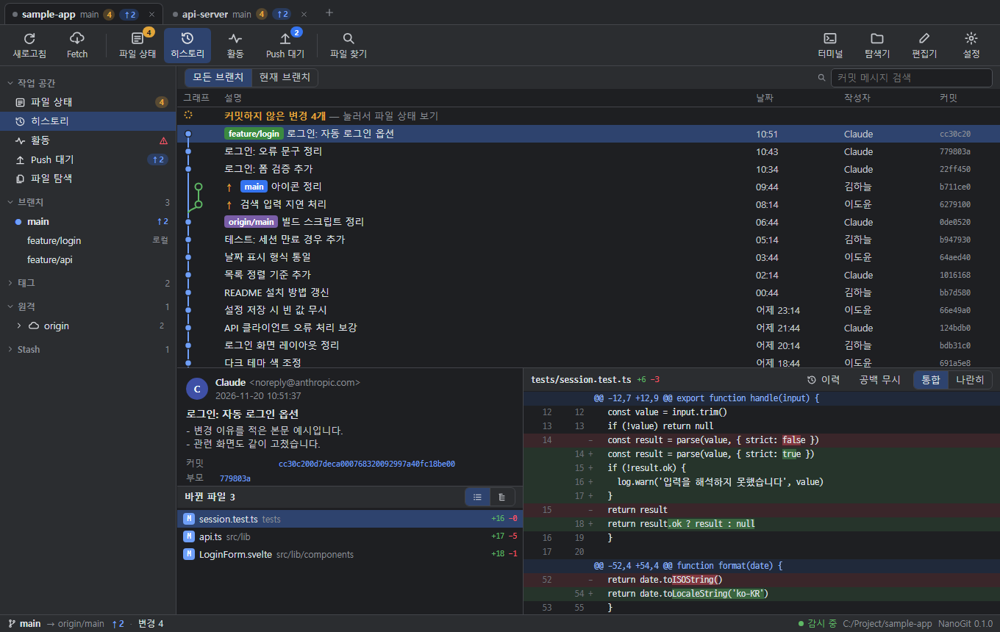
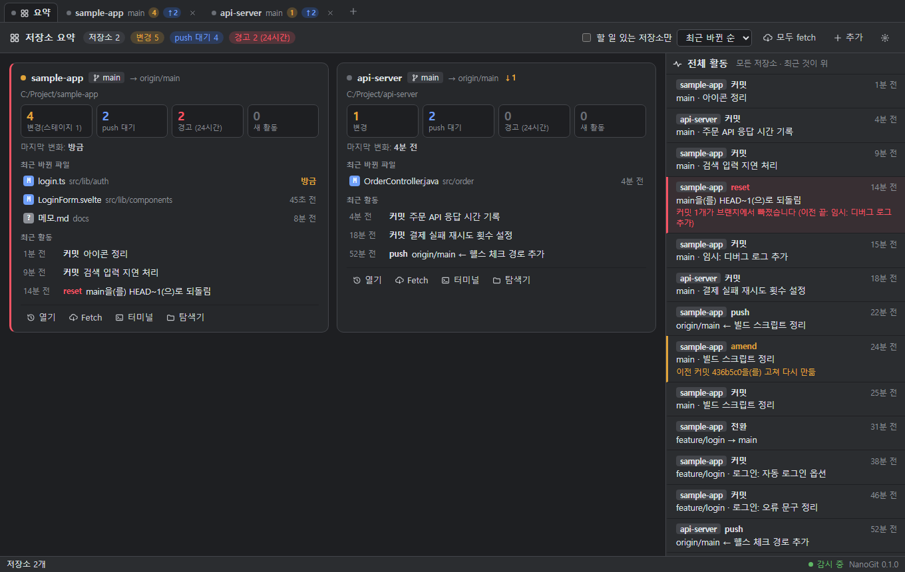
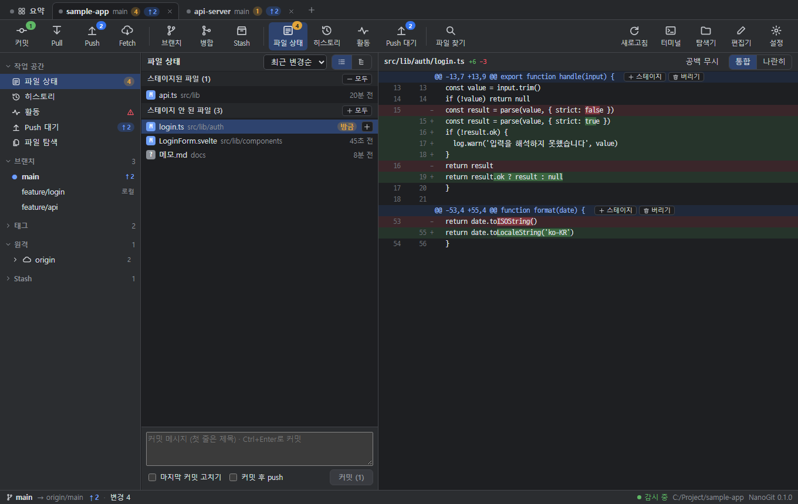

# NanoGit

**AI가 하는 git 작업을 지켜보는 가벼운 git 모니터**

[기획서](docs/PLANNING.md) · [개발 가이드](docs/DEVELOPMENT.md)

| 저장소 요약 (여러 저장소를 한눈에) | 파일 상태 (헝크 단위 스테이지·커밋) |
|---|---|
|  |  |

## NanoGit은

"커밋해 줘", "push해 줘" — git 작업은 이제 AI(Claude Code 등)에게 말로 시킵니다. 사람에게 남은 일은 **AI가 무엇을 했는지 확인하는 것**입니다.
NanoGit은 그 확인을 위한 앱입니다. 화면은 소스트리(SourceTree)와 같은 구성이고, 직접 조작보다 **지켜보기**에 집중합니다.

- 저장소를 실시간으로 감시합니다. AI가 파일을 고치거나 커밋·push하면 바로 화면에 보입니다.
- 간단한 작업(스테이지·커밋·push·pull·브랜치·병합·stash)은 AI 없이 직접 할 수도 있습니다. 감시만 하려면 설정에서 **감시 전용 모드**를 켜면 조작 버튼이 사라집니다.
- 설치 파일 몇 MB, 대기 메모리 100MB 이하를 목표로 합니다 (Tauri 2 + PC의 git).

## 주요 기능

| 기능 | 설명 |
|---|---|
| **저장소 요약** | 맨 앞 "요약" 탭(`Ctrl+0`)에서 열어 둔 모든 저장소를 카드로: 브랜치, 변경·push 대기·경고·새 활동 수, 마지막 변화, 최근 바뀐 파일, 최근 활동. 오른쪽에는 모든 저장소의 활동을 시간순으로 |
| **실시간 감시** | 작업 트리·커밋·브랜치·원격 변화를 1초 안에 반영. 바뀌는 저장소 탭은 점이 깜빡이고, 변경 수·push 대기 수가 붙습니다 |
| **Windows 알림** | AI가 커밋·push하거나 reset·강제 push·amend 같은 주의할 작업을 하면 앱을 보고 있지 않아도 알림으로. 한꺼번에 많이 생기면 묶어서 알리고, 종류별로 끌 수 있습니다 |
| **트레이 상주** | 창을 닫아도 트레이에서 감시를 계속합니다. 트레이 메뉴에 저장소별 변경·push 대기·새 활동, 알림 켜고 끄기, 모든 저장소 fetch. 새 활동이 있으면 아이콘에 빨간 점. Windows 시작 시 트레이로 실행할 수 있습니다 |
| **활동 타임라인** | AI가 한 커밋·amend·reset·전환·병합·rebase·push·fetch를 시간순으로. reset·강제 push로 **버려진 커밋**은 빨간 경고와 함께 그 자리에서 내용을 봅니다 |
| **Push 대기** | IntelliJ push 대화상자처럼 아직 push하지 않은 커밋과 바뀐 파일·diff. 원격이 앞서 있으면(pull 필요) 미리 알려 줍니다 |
| **파일 이력 (강화)** | 이름 변경까지 따라가는 이력, 두 버전 비교(Ctrl+클릭), 그 버전 내용, blame, 작업 트리와 비교, **선택한 줄만의 이력**(`git log -L`) |
| **구문 강조** | 파일 내용·blame·diff를 파일 종류에 맞는 색으로: Java·Kotlin·JS/TS·Vue·HTML·XML·yml·properties·JSON·SQL·CSS·Markdown·셸 등. **MyBatis 매퍼 XML은 태그 사이 SQL까지** 강조합니다 |
| **파일 상태** | 스테이지된·안 된 파일을 **최근 변경순**으로. AI가 방금 고친 파일이 맨 위에 "방금"으로 뜹니다 |
| **직접 조작** | 파일·헝크 단위 스테이지·언스테이지·버리기, 커밋(amend, 커밋 후 push), Push 대기에서 확인하고 push, pull, 브랜치·병합·stash·태그, cherry-pick·revert, 병합 충돌 계속·중단. 버리는 파일은 **휴지통**에 남아 되살릴 수 있습니다 |
| **히스토리** | 그래프, 브랜치·태그 배지, 모든 브랜치/현재 브랜치, push 안 한 커밋 표시. 검색은 메시지(본문 포함)·**커밋 ID(짧은 해시)**·브랜치·태그 이름으로, **작성자로 거르기**와 함께 쓸 수 있습니다 |
| **파일 우클릭 메뉴** | 어느 화면에서든 이력 조회 · Blame · 이 버전 내용 · 작업 트리와 비교 · 이 버전으로 되돌리기 · 스테이지 · 변경 버리기 · .gitignore에 추가 · 파일 열기 · 탐색기 · 경로·파일 이름 복사 |

## 설치

1. [Releases](https://github.com/hulbo/NanoGit/releases/latest)에서 `NanoGit_<버전>_x64-setup.exe`를 받아 실행합니다 (관리자 권한 없이 사용자 폴더에 설치됩니다).
2. PC에 [Git for Windows](https://git-scm.com/download/win)(2.30 이상)가 있어야 합니다. NanoGit은 설치된 git을 그대로 씁니다.
3. 코드 서명을 하지 않은 설치 파일이라 Windows SmartScreen이 경고할 수 있습니다. "추가 정보 → 실행"을 누르세요.
4. 그다음부터는 **앱 안에서 업데이트**합니다. 새 버전이 나오면 알림과 상태 표시줄의 "새 버전" 버튼이 뜨고, 누르면 받아서 설치한 뒤 다시 켜집니다 (v0.1.4부터. 설정에서 "업데이트 확인"으로 바로 볼 수도 있습니다).

## 빠르게 시작하기

1. **저장소 폴더 열기**로 저장소를 추가합니다 (하위 폴더를 골라도 루트를 찾습니다).
2. AI에게 평소처럼 일을 시킵니다. NanoGit의 **파일 상태**와 **활동**이 실시간으로 바뀝니다.
3. "push해 줘" 전에 **Push 대기**(`Ctrl+4`)에서 올라갈 커밋과 변경을 확인합니다. 그 자리에서 직접 **Push**해도 됩니다.
4. 파일이 왜 이렇게 됐는지 궁금하면 `Ctrl+Shift+R`(또는 `Ctrl+P`)로 파일을 찾아 이력을 봅니다. `*edu*`처럼 `*`, `?`로 이름 패턴을 쓸 수 있습니다.

## 단축키

| 동작 | 키 |
|---|---|
| 새로고침 | `F5` (`Ctrl+R`) |
| 파일 찾기 → 이력 조회 (`*`, `?` like 검색) | `Ctrl+Shift+R` (이클립스와 같음), `Ctrl+P` · Shift+Enter는 Blame |
| 저장소 요약 | `Ctrl+0` |
| 파일 상태 / 히스토리 / 활동 / Push 대기 / 파일 탐색 | `Ctrl+1` ~ `Ctrl+5` |
| 다음·이전 저장소 탭, 탭 닫기 | `Ctrl+Tab` / `Ctrl+Shift+Tab`, `Ctrl+W` |
| 커밋 (커밋 메시지 입력란에서) | `Ctrl+Enter` |
| 고른 파일 스테이지·언스테이지 (파일 상태 목록에서) | `Space` |

## 로드맵

| 단계 | 내용 | 상태 |
|---|---|---|
| M0~M2 | 기반, 모니터링(감시·활동·Push 대기·히스토리·파일 상태), 파일 이력 강화 | 완료 (v0.1.0) |
| M3 | 직접 조작: 스테이지·커밋·push·pull·브랜치·병합·stash·태그 | 완료 (v0.1.0) |
| M4 | Windows 알림, 트레이 상주, 여러 저장소 요약 | 완료 (v0.1.0) |

자세한 내용은 [기획서](docs/PLANNING.md)에 있습니다.

## 라이선스

[MIT](LICENSE)
