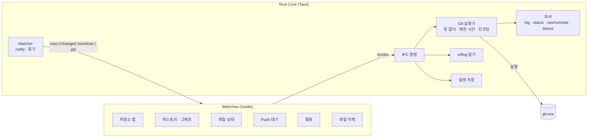

# NanoGit 기획서

> 문서 버전 0.2 · 2026-11-23 · 진행 상황: M0~M4 구현
>
> 왜 만드는지, 무엇을 어떻게 만들기로 했는지를 담은 기획서다. 앱 소개는 [README](../README.md), 빌드·코드 구조는 [개발 가이드](DEVELOPMENT.md)에 있다.

AI(Claude Code 등)가 대신 하는 git 작업을 **한눈에 지켜보는 가벼운 git 모니터**. 화면은 소스트리(SourceTree)와 같은 구성이고, 커밋·push 같은 조작보다 **지금 무엇이 바뀌었고, AI가 무엇을 했고, 무엇이 push될지를 보여 주는 것**이 먼저다.

---

## 목차

1. [배경과 문제](#1-배경과-문제)
2. [목표와 비목표](#2-목표와-비목표)
3. [사용자와 시나리오](#3-사용자와-시나리오)
4. [화면 설계](#4-화면-설계)
5. [기능 명세](#5-기능-명세)
6. [아키텍처](#6-아키텍처)
7. [비기능 요구사항](#7-비기능-요구사항)
8. [마일스톤](#8-마일스톤)
9. [리스크와 대응](#9-리스크와-대응)

---

## 1. 배경과 문제

요즘은 git 작업 대부분을 AI에게 말로 시킨다. "커밋해 줘", "push해 줘", "이 브랜치로 바꿔 줘"라고 하면 AI가 명령을 실행한다. 사람이 할 일은 **직접 조작이 아니라 확인과 감시**로 바뀌었다.

| 문제 | 내용 |
|---|---|
| AI가 한 일이 잘 안 보인다 | 터미널 출력은 금방 지나간다. 커밋이 몇 개 생겼는지, amend·reset·강제 push를 했는지 나중에 알기 어렵다. |
| push 전에 확인할 곳이 없다 | "push해 줘" 하기 전에 어떤 커밋과 파일이 올라가는지 보고 싶다. IntelliJ의 push 대화상자가 이걸 잘 보여 주지만 IDE를 켜야 한다. |
| 파일 이력 보기가 불편하다 | 소스트리의 파일 이력은 이름이 바뀐 파일을 잘 따라가지 못하고, 버전끼리 비교·blame·줄 단위 이력이 흩어져 있다. |
| 소스트리는 무겁다 | 설치·기동이 느리고, 조작 기능 위주라 "지켜보기"에는 과하다. |
| 여러 저장소를 동시에 본다 | AI 세션을 여러 개 띄워 저장소 여러 곳을 동시에 고친다. 어느 저장소가 지금 바뀌고 있는지 한 화면에서 보고 싶다. |

## 2. 목표와 비목표

### 목표

| ID | 목표 | 측정 기준 |
|---|---|---|
| G1 | **실시간 감시**: 작업 트리·커밋·브랜치·원격 변화가 바로 화면에 보인다 | AI가 파일을 고치거나 커밋하면 1초 안에 반영 |
| G2 | **활동 타임라인**: AI가 한 git 작업(커밋, amend, reset, 체크아웃, 병합, rebase, push, fetch)을 시간순으로 보여 주고 위험한 작업은 강조 | reset·강제 push로 버려진 커밋을 놓치지 않음 |
| G3 | **Push 대기 보기**: 아직 push하지 않은 커밋과 바뀐 파일·diff (IntelliJ push 대화상자처럼) | "push해 줘" 전에 앱 하나로 확인 끝 |
| G4 | **파일 이력 강화**: 이름 변경 추적, 두 버전 비교, 그 버전 내용, blame, 줄 단위 이력 | 파일 우클릭 한 번으로 모든 이력 정보 |
| G5 | **소스트리와 같은 화면**: 저장소 탭, 왼쪽 사이드바, 히스토리 그래프, 아래 커밋 정보·diff | 소스트리 사용자가 설명 없이 사용 |
| G6 | **가벼움** | 설치 파일 15MB 이하, 대기 메모리 100MB 이하, 기동 1초 |

### 비목표 (1차)

- 커밋·push·pull·브랜치 만들기·병합·stash 같은 **직접 조작**: AI에게 시키면 된다. 감시 기능을 다 만든 뒤 M3에서 편의 기능으로 추가했다 (5.10). 설정의 **감시 전용 모드**로 끌 수 있다.
- 충돌 해결 도구, Git Flow, 서브모듈 관리
- GitHub PR·이슈 연동
- 저장소 내용 편집

단, 저장소를 망가뜨리지 않는 **fetch**는 원격 상태를 보려고 1차부터 넣는다.

## 3. 사용자와 시나리오

**대상 사용자**: Claude Code 같은 AI 에이전트에게 개발과 git 작업을 맡기고, 결과를 눈으로 확인하는 개발자.

| # | 시나리오 | 흐름 |
|---|---|---|
| S1 | AI가 파일을 고치는 중 | **파일 상태**에 바뀐 파일이 실시간으로 쌓이고, 방금 바뀐 파일이 맨 위에 "방금" 표시와 함께 뜬다. 파일을 고르면 diff가 바로 보인다. |
| S2 | "커밋해 줘" | AI가 커밋하면 **활동**에 `커밋 · 로그인 화면 수정`이 뜨고, 히스토리 그래프 맨 위에 새 커밋이 생긴다. 저장소 탭에 `↑1` 배지가 붙는다. |
| S3 | "push해 줘" 전에 확인 | 툴바 **Push 대기(3)** → 왼쪽에 올라갈 커밋 3개, 오른쪽에 바뀐 파일 7개. 파일을 고르면 diff. 이상 없으면 AI에게 push를 시킨다. |
| S4 | AI가 위험한 작업을 함 | `reset --hard`로 커밋 2개를 버렸거나 강제 push를 하면 활동에 **빨간 경고**와 "버려진 커밋 2개 보기"가 뜬다. 버려진 커밋도 그 자리에서 내용을 볼 수 있다. |
| S5 | 파일이 언제 왜 바뀌었는지 | 파일 우클릭 → **이력 조회** → 이름이 바뀐 이력까지 따라간 커밋 목록. 두 커밋을 골라 비교, 그 버전 내용 보기, blame, 줄을 골라 그 줄만의 이력. |
| S6 | 여러 저장소 동시 감시 | 저장소 탭 여러 개. 바뀌고 있는 탭은 점이 깜빡이고, 탭마다 변경 수·push 대기 수가 붙는다. |

## 4. 화면 설계

### 4.1 메인 화면 (소스트리 구성)

```
+------------------------------------------------------------------------------------+
| [● my-app  5 ↑3] [ api-server ] [+]                                                |
+------------------------------------------------------------------------------------+
| [새로고침] [Fetch] | [Push 대기 3] [활동] | [파일 찾기] | [터미널] [탐색기]  ... [설정] |
+-------------------+----------------------------------------------------------------+
| 작업 공간          |  그래프 | 설명                              | 날짜  | 작성자 | 커밋  |
|   파일 상태    5   |  ●      [main] 로그인 화면 수정              | 10:21 | hulbo  | a1b2c |
|   히스토리         |  ●─┐    병합: feature/api                   | 09:58 | hulbo  | 9f8e7 |
|   활동         2   |  │ ●    [origin/main] API 클라이언트 정리     | 어제  | hulbo  | 3c4d5 |
|   Push 대기    3   +----------------------------+-----------------------------------+
|   파일 탐색        | 커밋 정보                   |  diff (선택한 파일)                 |
| 브랜치             |  메시지 전체, 작성자, 부모     |  @@ -10,6 +10,8 @@                 |
|   ● main   ↑3 ↓0   |  바뀐 파일 목록              |  - old                            |
|     feature/login  |   M src/App.svelte  +12 -3  |  + new                            |
| 태그               |   A src/login.ts    +80     |                                   |
| 원격               |                            |                                   |
|   ▸ origin         |                            |                                   |
| Stash              |                            |                                   |
+-------------------+----------------------------+-----------------------------------+
| main → origin/main · ↑3 ↓0 · 변경 5 · 감시 중                          NanoGit 0.1.0 |
+------------------------------------------------------------------------------------+
```

- **저장소 탭**: 여러 저장소를 탭으로 연다(소스트리와 같음). 탭마다 변경 수, push 대기 수, 방금 바뀌면 깜빡이는 점.
- **툴바**: 커밋·Pull·Push·Fetch | 브랜치·병합·Stash | 파일 상태·히스토리·활동·Push 대기 | 파일 찾기 … 새로고침·터미널·탐색기·편집기·설정. 감시 전용 모드면 조작 버튼을 숨긴다. 창이 좁으면 아이콘만 보인다.
- **사이드바**: 작업 공간(파일 상태, 히스토리, 활동, Push 대기, 파일 탐색), 브랜치(ahead/behind), 태그, 원격(원격 브랜치), Stash. 항목을 고르면 히스토리에서 그 커밋으로 이동.
- **상태 표시줄**: 현재 브랜치와 추적 브랜치, ahead/behind, 변경 수, 진행 중인 작업(병합·rebase 중), 감시 상태.

### 4.2 파일 상태 (작업 트리)

```
+----------------------------------+---------------------------------------------+
| 스테이지된 파일 (2)                | src/App.svelte                     [통합|나란히] |
|   M src/App.svelte        방금    |  @@ -10,6 +10,8 @@                          |
|   A src/login.ts                 |   import ...                                |
| 스테이지 안 된 파일 (3)            |  -old line                                  |
|   M README.md             12초 전 |  +new line                                  |
|   ? notes.txt                    |                                             |
| [정렬: 최근 변경순 ▾] [트리|목록]   |                                             |
+----------------------------------+---------------------------------------------+
```

- 실시간 갱신. 기본 정렬은 **최근 변경순**(파일 수정 시각)이라 AI가 지금 만지는 파일이 위로 온다.
- M3: 줄에 마우스를 올리면 ＋(스테이지)·－(언스테이지) 버튼, `Space`로도 된다. 목록 머리에 "모두" 버튼.
- M3: diff의 헝크마다 [스테이지] [버리기] / [언스테이지] 버튼 (수정된 파일만, 공백 무시 중에는 숨김).
- M3: 아래 커밋 입력란 (`Ctrl+Enter`), "마지막 커밋 고치기(amend)", "커밋 후 push". 병합·rebase 중이면 위에 [계속] [중단] 줄.

### 4.3 Push 대기 (IntelliJ push 대화상자처럼)

```
+-------------------------------------+-----------------------------------------+
| ▾ main → origin/main      커밋 3     | 바뀐 파일 7            [트리|목록]        |
|    ● 로그인 화면 수정   hulbo  10:21  |  ▾ src/                                  |
|    ● API 클라이언트 정리 hulbo 09:58  |     M App.svelte          +12 -3        |
|    ● README 정리        hulbo  어제   |     A login.ts            +80           |
|                                     |  D old.ts                     -40       |
|  원격에 내가 없는 커밋 1개 (pull 필요) +-----------------------------------------+
|                                     |  diff (선택한 파일)                       |
+-------------------------------------+-----------------------------------------+
```

- 왼쪽: 브랜치별로 아직 push하지 않은 커밋. 브랜치 줄을 고르면 오른쪽은 **전체 합친 변경**, 커밋을 고르면 그 커밋의 변경.
- 추적 브랜치가 없으면 "새 브랜치로 올라감"과 원격에 없는 커밋을 보여 준다.
- 원격이 앞서 있으면(behind) "push가 거부될 수 있음, 먼저 pull 필요"를 알린다.
- 기본은 현재 브랜치, "모든 브랜치"를 켜면 push 대기 커밋이 있는 로컬 브랜치를 모두 보여 준다.
- M3: 머리의 **Push** 버튼 → 올라갈 커밋을 한 번 더 보여 주는 확인 창 → push. 원격이 앞서 있으면 그 자리에 Pull 버튼.

### 4.4 활동 (AI가 한 일 타임라인)

```
+----------------------------------------------------------------------------------+
| [전체 | 커밋 | 브랜치 | 원격 | 경고만]                           [저장소: 전체 ▾]   |
+----------------------------------------------------------------------------------+
| 10:30  ⚠ reset   main을 9f8e7d로 되돌림 · 버려진 커밋 2개 [보기]                   |
| 10:25  ✎ amend   로그인 화면 수정 (a1b2c3 → d4e5f6)                               |
| 10:21  ● 커밋    로그인 화면 수정                                                  |
| 10:15  ↑ push    origin/main ← main (3 커밋)                                      |
| 10:02  ⇄ 전환    feature/login → main                                             |
| 09:58  ⑂ 병합    feature/api → main (fast-forward)                                |
+----------------------------------------------------------------------------------+
```

- git이 남기는 **reflog**(HEAD, 로컬 브랜치, 원격 추적 브랜치, stash)를 읽어 만든다. 앱을 켜 두지 않았을 때 일어난 일도 보인다.
- 줄을 고르면 그 시점의 커밋 정보와 diff를 아래에 보여 준다.
- **경고**: reset으로 커밋이 버려짐, 강제 push·강제 fetch(이력 재작성), rebase, amend, 분리된 HEAD.

### 4.4.1 저장소 요약

```
+--------------------------------------------------------------------------------------+
| [▦ 요약] [● my-app 5 ↑3] [api-server ↑2]                                             |
+--------------------------------------------------------------------------------------+
| 저장소 요약  저장소 2 · 최근 1분 안에 바뀜 1 · 변경 6 · push 대기 5 · 경고 1   [최근 바뀐 순 ▾] |
+-----------------------------------------------------------+--------------------------+
| ● my-app  [main] → origin/main            | ● api-server  | 전체 활동                  |
| 변경 5 | push 대기 3 | 경고 1 | 새 활동 2   | ...           | my-app   커밋     1분 전   |
| 마지막 변화: 12초 전                        |               | api      커밋     4분 전   |
| 최근 바뀐 파일  login.ts 12초 전 ...        |               | my-app ⚠ reset   14분 전   |
| 최근 활동  커밋 · reset ...                 |               | ...                       |
| [열기] [Fetch] [터미널] [탐색기]            |               |                           |
+-----------------------------------------------------------+--------------------------+
```

- 저장소 탭 맨 앞의 **요약** 탭(`Ctrl+0`). 여러 AI 세션이 여러 저장소를 동시에 고칠 때 한 화면에서 본다.
- 카드: 브랜치·추적 브랜치·↓(pull 필요)·진행 중 작업, 변경·push 대기·경고(24시간)·새 활동 수, 마지막 변화 시각, 최근 바뀐 파일 3개, 최근 활동 3개. 숫자 칸을 누르면 그 저장소의 해당 화면(파일 상태·Push 대기·활동)으로 간다.
- 정렬: 최근 바뀐 순(기본) / 탭 순서 / 이름순. "할 일 있는 저장소만"으로 깨끗한 저장소를 숨긴다.
- 오른쪽 **전체 활동**: 모든 저장소의 reflog 활동을 시간순으로 합친 타임라인.

### 4.5 파일 이력 (강화)

```
+----------------------------------------------------------------------------------+
| 파일 이력: src/lib/login.ts   [✓ 이름 변경 따라가기] [검색 ____] [작성자 ▾]          |
+-----------------------------------+----------------------------------------------+
| ● a1b2c3 로그인 수정  hulbo 10:21  | [변경 내용] [이 버전 내용] [Blame] [작업 트리와] |
|          +12 -3                    |                                              |
| ● 9f8e7d 이름 변경                 |  diff ...                                    |
|          auth.ts → login.ts        |                                              |
| ● 3c4d5e 처음 추가                 |                                              |
+-----------------------------------+----------------------------------------------+
| 커밋 정보: 메시지 전체 · 같이 바뀐 파일 6개                                            |
+----------------------------------------------------------------------------------+
```

- 이름 변경을 따라가며(`--follow`) 커밋마다 그때의 경로와 +/− 줄 수를 보여 준다.
- 커밋 하나: 그 커밋에서 이 파일의 변경. **커밋 두 개(Ctrl+클릭)**: 두 버전 사이 비교.
- **이 버전 내용**: 그 커밋 시점의 파일 전체. 줄을 드래그해 고르면 **선택한 줄의 이력**(`git log -L`).
- **Blame**: 줄마다 마지막으로 바꾼 커밋. 커밋을 누르면 그 커밋의 이력 행으로 이동.
- **작업 트리와 비교**: 그 버전과 지금 파일의 차이.
- 같이 바뀐 다른 파일 목록에서 다른 파일의 이력으로 이어 갈 수 있다.

### 4.6 파일 우클릭 메뉴

파일 상태, 커밋의 바뀐 파일, Push 대기, 파일 탐색, 파일 이력 어디서든 같은 메뉴를 쓴다.

| 메뉴 | 1차 | 비고 |
|---|---|---|
| 이력 조회 | ✓ | 4.5 화면 |
| Blame | ✓ | 파일 이력의 Blame 탭으로 |
| 이전 버전과 비교 / 작업 트리와 비교 | ✓ | |
| 이 버전 내용 보기 | ✓ | |
| 파일 열기 / 탐색기에서 보기 / 편집기로 열기 | ✓ | |
| 경로 복사 / 상대 경로 복사 / 파일 이름 복사 / 커밋 해시 복사 | ✓ | |
| 스테이지 / 언스테이지 / 변경 버리기 / 이 버전으로 되돌리기 / .gitignore에 추가 | ✓ (M3) | 직접 조작, 감시 전용 모드면 숨김 |

### 4.7 단축키

| 동작 | 키 |
|---|---|
| 새로고침 | `F5`, `Ctrl+R` |
| 파일 찾기 (이력 조회로 열기, `*`·`?` 와일드카드) | `Ctrl+Shift+R` (이클립스 Open Resource), `Ctrl+P` |
| 파일 상태 / 히스토리 / 활동 / Push 대기 | `Ctrl+1` / `Ctrl+2` / `Ctrl+3` / `Ctrl+4` |
| 다음·이전 저장소 탭 | `Ctrl+Tab` / `Ctrl+Shift+Tab` |
| 커밋 검색 | `Ctrl+F` |
| 커밋 (커밋 메시지 입력란에서) | `Ctrl+Enter` |
| 고른 파일 스테이지·언스테이지 | `Space` |

## 5. 기능 명세

### 5.1 저장소 관리

- 폴더를 골라 저장소를 추가한다(하위 폴더를 고르면 위로 올라가 저장소 루트를 찾는다. worktree·submodule의 `.git` 파일도 따라간다).
- 열어 둔 탭과 최근 저장소 목록을 저장해 다음 실행 때 그대로 연다.
- 저장소 폴더가 없어지면 탭에 표시하고 감시를 멈춘다.

### 5.2 실시간 감시

- 저장소 폴더 전체를 파일 시스템 감시(Windows `ReadDirectoryChangesW`)로 본다.
- 바뀐 경로가 `.git` 안이면 **git 상태 변화**(HEAD, index, refs, reflog), 밖이면 **작업 트리 변화**로 나눠 알린다. `.git/objects` 같은 잡음은 무시한다.
- 짧은 시간에 몰리는 변경은 묶는다(300ms 대기, 최대 1초에 한 번). 빌드처럼 파일이 쏟아져도 화면이 버벅이지 않는다.
- 창이 다시 활성화될 때와 `F5`에서도 새로 읽는다.
- (선택) 주기적 fetch: 설정한 분마다 원격을 가져와 behind를 갱신한다. 기본은 끔(인증 창이 갑자기 뜨지 않게).

### 5.3 히스토리

- 그래프(레인), 설명(브랜치·태그 배지 포함), 날짜, 작성자, 커밋 해시 열. 소스트리처럼 **모든 브랜치 / 현재 브랜치** 전환.
- 500개씩 나눠 읽고, 스크롤하면 더 읽는다. 화면에 보이는 줄만 그린다(가상 스크롤).
- 검색: 메시지, 작성자, 해시, 파일 경로.
- 아래 패널: 커밋 정보(메시지 전체, 작성자·커미터, 날짜, 부모, 포함된 브랜치) + 바뀐 파일 목록(+/− 줄 수) + diff.
- 아직 push하지 않은 커밋은 행에 표시(↑)한다.

### 5.4 diff 보기

- 통합(unified) 보기 기본, 나란히(side-by-side) 보기 전환.
- 줄 번호, 단어 단위 강조(바뀐 줄 쌍), 공백 무시 토글, 문맥 줄 수.
- 이진 파일·너무 큰 파일은 요약만. UTF-8이 아닌 파일은 CP949로 읽는다(한글 레거시 파일).

### 5.5 Push 대기

- 추적 브랜치가 있으면 `@{upstream}..브랜치`, 없으면 같은 이름의 원격 브랜치, 그것도 없으면 그 원격의 어떤 브랜치에도 없는 커밋.
- 합친 변경은 가장 오래된 대기 커밋의 부모와 브랜치 끝의 diff(루트 커밋이면 빈 트리와 비교).
- behind가 있으면 경고. 원격 정보가 오래됐을 수 있으니 Fetch 버튼을 같이 둔다.

### 5.6 활동

reflog 파일(`.git/logs/HEAD`, `.git/logs/refs/**`)을 직접 읽어 시간순으로 합친다.

| reflog 메시지 | 종류 | 경고 |
|---|---|---|
| `commit:` / `commit (initial):` / `commit (merge):` | 커밋 | |
| `commit (amend):` | amend | 주의 (이전 커밋이 이력에서 빠짐) |
| `checkout: moving from A to B` | 전환 | 커밋으로 전환하면 분리된 HEAD 주의 |
| `reset: moving to X` | reset | 이전 위치에서 버려진 커밋이 있으면 경고 |
| `merge X:` / `pull:` | 병합·pull | |
| `rebase (...)` | rebase | 주의 |
| `cherry-pick:` / `revert:` | 커밋 | |
| 원격 추적 브랜치 `update by push` | push | 이전 위치가 새 위치의 조상이 아니면 **강제 push** 경고 |
| 원격 추적 브랜치 `fetch:` | fetch | `forced-update`면 원격 이력 재작성 경고 |
| `branch: Created from` / `Branch: renamed` | 브랜치 | |
| `refs/stash` | stash | |

같은 작업이 HEAD와 브랜치 reflog에 두 번 남으면 하나로 합친다.

### 5.6.1 Windows 알림

활동 타임라인에 새 항목이 생기면(실시간 감시가 `.git` 변화를 알릴 때마다 reflog를 다시 읽어 비교) Windows 알림을 보낸다. 뒤쪽 탭의 저장소도 알린다.

| 묶음 | 포함 | 기본 |
|---|---|---|
| 커밋 | 커밋, 첫 커밋, 병합 커밋, cherry-pick, revert | 켬 |
| push | 원격 추적 브랜치 `update by push` | 켬 |
| 주의 | reset(버려진 커밋), 강제 push, amend, rebase, 분리된 HEAD, 원격 이력 재작성 | 켬 |
| 브랜치 | 전환, 병합, pull, 브랜치 생성·이름 변경, stash | 끔 |

- fetch(정상)는 알리지 않는다 (주기적 fetch가 알림을 쏟아내지 않게).
- 한 번에 최대 3개. 주의 항목은 하나씩, 나머지가 많으면 "새 활동 5개 · 커밋 4 · push 1"처럼 하나로 묶는다. 이어진 rebase 단계는 하나로 센다.
- 기본은 NanoGit 창을 보고 있지 않을 때만 알린다 (보고 있으면 앱 안의 알림으로 충분). 설정에서 바꿀 수 있다.
- 알림은 Windows 알림 센터에도 남는다.

### 5.7 파일 이력

| 기능 | git |
|---|---|
| 이력 목록(이름 변경 추적) | `git log --follow -M --raw --numstat -z -- <경로>` |
| 커밋에서 이 파일의 변경 | `git diff <부모> <커밋> -M -- <이전 경로> <경로>` |
| 두 버전 비교 | `git diff <커밋A>:<경로A> <커밋B>:<경로B>` |
| 이 버전 내용 | `git show <커밋>:<경로>` |
| Blame | `git blame --porcelain <커밋> -- <경로>` |
| 선택한 줄 이력 | `git log -L <시작>,<끝>:<경로> <커밋>` |
| 같이 바뀐 파일 | 커밋 상세의 바뀐 파일 목록 |

### 5.8 설정

`%APPDATA%\NanoGit\settings.json` (환경변수 `NANOGIT_HOME`으로 바꿀 수 있음)

- 열린 탭·최근 저장소, 테마(시스템/다크/라이트), 글꼴, 주기적 fetch 간격, 히스토리 기본 범위(모든 브랜치/현재), diff 보기 방식, 외부 편집기 명령, 터미널 종류(Windows Terminal / PowerShell / Git Bash).

### 5.9 트레이 상주

하루 종일 켜 두고 감시하는 앱이므로 창을 닫아도 끝나지 않는다.

- **창 닫기**: 기본은 트레이로 숨기고 감시·알림을 계속한다 (설정에서 끄면 닫을 때 종료). 처음 숨길 때 한 번 알려 준다.
- **트레이 아이콘**: 왼쪽 클릭은 창 열기. 확인하지 않은 새 활동이 있으면 아이콘에 빨간 점. 툴팁은 합계 (`NanoGit · 변경 5 · push 대기 2 · 새 활동 1`).
- **트레이 메뉴**: NanoGit 열기 / 저장소마다 한 줄(`my-app (main) · 변경 3 · push 대기 2`, 고르면 그 탭으로 열림) / 알림 받기(체크) / 모든 저장소 fetch / 종료.
- **Windows 시작 시 실행**: 켜면 `HKCU\Software\Microsoft\Windows\CurrentVersion\Run`에 `"nanogit.exe" --tray`를 등록한다. `--tray`로 시작하면 창 없이 트레이에서 감시만 한다.
- 두 번째로 실행하면 트레이에 숨은 창을 앞으로 가져온다 (단일 인스턴스).

### 5.10 직접 조작 (M3)

간단한 작업은 AI 없이 직접 한다. 모든 조작은 확인 창을 거치고, 끝나면 화면을 바로 다시 읽는다. 실패하면 git이 남긴 글의 핵심 한 줄을 알림으로, 전체는 "자세히"로 보여 준다.

| 조작 | git | 안전장치 |
|---|---|---|
| 스테이지 / 언스테이지 | `add -A` / `reset HEAD` (첫 커밋 전에는 `rm --cached`) | 경로는 `:(literal)` + `--pathspec-from-file` |
| 헝크 스테이지·언스테이지·버리기 | 같은 diff를 다시 만들어 그 헝크만 `apply --cached` / `-R` | 헝크 머리가 다르면(그새 바뀜) 거부. 새 파일·이름 변경은 파일 단위로 |
| 변경 버리기 | `restore --worktree` (스테이지까지면 `--source=HEAD --staged`) | 지금 파일을 **휴지통**에 남긴 뒤 되돌림 |
| 커밋 | `commit --file=-` (`--amend`) | 이미 push한 커밋을 고치면 강제 push가 필요하다고 알림 |
| push | 추적 브랜치로, 없으면 같은 이름으로 올리고 추적 설정 | 강제는 `--force-with-lease`만, 두 번 확인 |
| pull | `pull --no-rebase` / `--rebase` / `--ff-only` (설정에 기억) | |
| 브랜치 | 만들기(`switch -c`), 전환(더블클릭), 원격 브랜치 체크아웃(`--track`), 이름 바꾸기, 삭제 | 이름은 `check-ref-format`. 병합 안 된 브랜치 삭제는 한 번 더 확인 |
| 병합 | `merge --no-edit` (`--no-ff` 선택) | 충돌이 나면 파일 상태에 [계속] [중단] |
| stash | `stash push` (새 파일 포함 선택), 적용, 꺼내기, 삭제 | |
| 태그 | 만들기(메시지를 쓰면 주석 태그), push, 삭제 | |
| 커밋 메뉴 | 여기서 브랜치·태그, 커밋으로 전환(분리된 HEAD), cherry-pick, revert | |
| 파일 메뉴 | 이 버전으로 되돌리기(`restore --source`), .gitignore에 추가 | 되돌리기 전 파일은 휴지통에 |

- 창 없는 git이 편집기를 기다리며 멈추지 않게 `GIT_EDITOR=true`로 실행한다.
- 한 저장소에서는 조작을 한 번에 하나만 실행한다. AI의 git 명령이 `index.lock`을 잡고 있으면 git 오류를 그대로 보여 준다.
- 내가 한 조작이 남긴 reflog는 새 활동 알림으로 다시 알리지 않는다 (조작 알림으로 충분).
- reset·rebase처럼 이력을 지우는 조작은 아직 넣지 않았다 (AI에게 맡김).

## 6. 아키텍처

### 6.1 기술 스택

[Services Dashboard](https://github.com/hulbo/ServicesDashboard)와 같은 구성을 쓴다.

| 영역 | 기술 | 이유 |
|---|---|---|
| 앱 셸 | Tauri 2 (WebView2) | 설치 수 MB, 메모리 적음 |
| 백엔드 | Rust | git 실행·파싱·파일 감시·reflog 읽기 |
| 화면 | Svelte 5 + TypeScript + Vite | 가상 스크롤·그래프를 가볍게 |
| git | PC에 설치된 **git 명령** | 사용자의 설정·인증(Git Credential Manager)·hook을 그대로 쓴다. libgit2를 넣지 않아 가볍다 |
| 파일 감시 | `notify` 크레이트 | Windows `ReadDirectoryChangesW` |

### 6.2 구성도



### 6.3 git 실행 원칙

- 창 없이(`CREATE_NO_WINDOW`) 실행하고 제한 시간을 둔다(조회 20초, fetch 180초).
- `-c core.quotepath=false -c color.ui=never`로 한글 경로를 그대로 받는다.
- `GIT_TERMINAL_PROMPT=0`, `GIT_OPTIONAL_LOCKS=0`: 감시용 조회가 `index.lock`을 잡아 AI의 git 명령과 부딪히지 않게 한다.
- 출력은 바이트로 받아 UTF-8이 아니면 CP949로 해석한다.
- 조회 명령은 저장소를 바꾸지 않는다. 저장소를 바꾸는 명령은 `git/ops.rs`의 `git_op` 하나로만 들어온다 (5.10).

### 6.4 IPC 초안

| 구분 | 이름 | 설명 |
|---|---|---|
| Command | `app_info` | 앱 버전, git 경로·버전 |
| Command | `repos_get`, `repo_add`, `repo_remove`, `tabs_save` | 저장소 목록·탭 |
| Command | `repo_summary` | 브랜치, 추적 브랜치, ahead/behind, 진행 중 작업, 변경 수 |
| Command | `refs_get` | 로컬·원격 브랜치, 태그, stash |
| Command | `log_get` | 커밋 목록 (범위, 건너뛰기, 개수, 검색) |
| Command | `commit_get` | 커밋 상세 + 바뀐 파일 |
| Command | `status_get` | 스테이지·작업 트리·추적 안 함·충돌 파일 (수정 시각 포함) |
| Command | `diff_get` | 작업 트리 / 스테이지 / 커밋 / 두 버전 diff |
| Command | `outgoing_get` | push 대기 커밋과 합친 변경 |
| Command | `activity_get` | reflog 타임라인 |
| Command | `file_history`, `file_blame`, `file_content`, `line_history`, `files_list` | 파일 이력 |
| Command | `fetch` | 원격 가져오기 |
| Command | `git_op` | 직접 조작 (`{ kind: 'stage' \| 'commit' \| 'push' \| … }`, git이 남긴 글을 돌려줌) |
| Command | `watch_set` | 감시할 저장소 목록 |
| Command | `open_path`, `reveal_path`, `open_terminal`, `open_editor` | 외부 프로그램 |
| Event | `repo://changed` | `{ root, worktree, git }` |

## 7. 비기능 요구사항

| 구분 | 요구 |
|---|---|
| 성능 | 기동 1초, 대기 메모리 100MB 이하, 커밋 10만 개 저장소에서도 첫 화면 1초 |
| 안전 | 조회가 index.lock을 잡지 않는다. 조작은 확인을 거치고, 버리는 파일은 휴지통에 남긴다. 감시 전용 모드로 조작을 막을 수 있다 |
| 호환성 | Windows 10/11 우선. git 2.30 이상 |
| 개인정보 | 외부 전송·텔레메트리 없음. 설정은 로컬에만 |
| 배포 | GitHub Actions로 NSIS 설치본 빌드, GitHub Releases |

## 8. 마일스톤

| 단계 | 범위 | 완료 기준 | 상태 |
|---|---|---|---|
| **M0 기반** | Tauri 2 + Svelte 5 구성, CI, 브라우저 미리보기용 가짜 백엔드, git 실행기와 파서 | 빈 창 대신 저장소 하나의 히스토리가 뜸 | 완료 |
| **M1 모니터링 MVP** | 저장소 탭, 사이드바, 히스토리 그래프·커밋 상세·diff, 파일 상태(보기), 실시간 감시, Push 대기, 활동 타임라인, Fetch | AI에게 일을 시키고 NanoGit만으로 결과 확인 | 완료 |
| **M2 파일 이력 강화** | 파일 이력(이름 변경 추적, 두 버전 비교, 내용, blame, 줄 이력), 파일 탐색·`Ctrl+P`, 우클릭 메뉴, 나란히 diff, 단어 강조 | 파일이 왜 이렇게 됐는지 앱 안에서 추적 끝 | 완료 |
| **M3 직접 조작** | 스테이지·언스테이지·폐기(헝크 단위), 커밋(amend, 커밋 후 push), push·pull·브랜치·병합·stash·태그 | 간단한 작업은 AI 없이도 | 완료 |
| **M4 편의** | Windows 알림(커밋·push·위험 작업), 트레이 상주, 여러 저장소 요약 대시보드, 설정 화면 | 하루 종일 켜 두는 감시 창 | 완료 |

## 9. 리스크와 대응

| 리스크 | 대응 |
|---|---|
| 감시용 `git status`가 `index.lock`을 잡아 AI의 git 명령이 실패 | `GIT_OPTIONAL_LOCKS=0`으로 조회 |
| 빌드 중 파일 변경이 쏟아져 status를 계속 실행 | 묶기(300ms) + 최대 1초에 한 번 + 결과가 같으면 화면 갱신 안 함 |
| 큰 저장소에서 log·status가 느림 | 500개씩 나눠 읽기, 가상 스크롤, 제한 시간 |
| reflog가 꺼져 있거나 만료됨 | 활동은 남은 기록만 보여 주고, 실시간 감시 중 감지한 변화로 보완 |
| 강제 push 판별 | reflog의 이전·새 위치로 `merge-base --is-ancestor` 확인 |
| CP949 파일 diff 깨짐 | UTF-8 검사 후 CP949로 해석 |
| 백그라운드 fetch가 인증 창을 띄움 | 주기적 fetch는 기본 끔, `GIT_TERMINAL_PROMPT=0` |
| 직접 조작이 AI의 git 작업과 겹침 | 한 저장소에 조작 하나씩. `index.lock` 오류는 그대로 보여 주고, 감시 전용 모드로 조작을 끌 수 있음 |
| 잘못 버린 변경 | 버리기·되돌리기 전에 지금 파일을 휴지통에 남김. 강제 push는 `--force-with-lease`만 |
